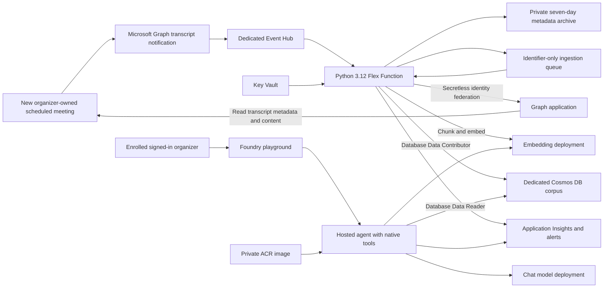

# Teams transcripts in Microsoft Foundry

Deploy a private, seven-day transcript assistant into **one Azure subscription** and use it from the **Foundry playground**.
The Function captures new scheduled meetings for explicitly enrolled organizers, and the hosted agent lists, searches and reads only the signed-in organizer's corpus.
Start with your own Entra object ID and one organizer.
The sample is MIT licensed, uses Bicep and Azure CLI, and requires no pipeline, web app or separate chat client.
Hosted agents and their APIs are preview features: confirm availability in your tenant, subscription and selected region before deploying.

## Architecture



Everything belongs to one dedicated resource group, including Foundry account/project, chat and embedding deployments, ACR, Event Hub, Function, user-assigned identity, private storage, Key Vault, Cosmos DB and monitoring.
The Entra Graph application and Teams policies are tenant resources and require separate cleanup.
Storage and Cosmos use authenticated public service endpoints to support Flex and hosted agents; **private means no anonymous/shared-key data access**, not private endpoints or VNet isolation.
The Graph application trusts the Function managed identity through an `api://AzureADTokenExchange` federated credential; no Graph client secret or certificate is created.

## Prerequisites and permissions

You need Python 3.12, Azure CLI with Bicep 0.48.1 or later, Docker supporting Linux/amd64, PowerShell 7 and the MicrosoftTeams module.
`uv` is convenient for separate Python environments; standard virtual environments work too.
Use a Teams/Microsoft 365 license and an organizer meeting policy that permits transcription.
A Teams Administrator must inspect tenant settings and organizer policies.
An administrator authorized to consent to Microsoft Graph application permissions must grant consent independently of the Teams policy assignment.
The deployment operator must be a signed-in user in the organizer tenant, enrolled in the initial configuration.
The helper rejects an application-only deployment session for initial delegated-user verification.

| Principal | Permission and scope | Purpose |
|---|---|---|
| Deployment operator | Contributor plus RBAC Administrator, or Owner, on the dedicated resource group; resource-provider registration rights if needed | Provision resources, apply Azure RBAC and deploy immutable versions |
| Deployment operator | Entra permission to create applications, service principals and federated credentials | Create the secretless Graph app and trust |
| Graph administrator | Authority to grant Microsoft Graph application admin consent | Consent to `OnlineMeetingTranscript.Read.All` |
| Teams administrator | Teams Administrator, including fresh active PIM role if applicable | Read tenant configuration and assign organizer policies |
| Graph application | `OnlineMeetingTranscript.Read.All` application role **and** organizer application access policy | Read the configured organizer's transcripts and create subscriptions |
| Microsoft Graph Change Tracking service principal and Graph application | Event Hubs Data Sender, dedicated hub only | Deliver notifications and validate subscription delivery |
| Function identity | Event Hubs Data Receiver, dedicated hub only | Process broker notifications |
| Function identity | Storage Blob Data Owner, Queue Data Contributor and Storage Account Contributor, dedicated storage account | Host checkpoints, Flex packages, archive/state, ingestion queues |
| Function identity | Key Vault Secrets User, two dedicated secret scopes | Resolve notification verification and embedding references |
| Deployment operator | Secrets Officer, same two secret scopes | Bootstrap the verification and embedding secrets |
| Function identity | Cosmos Built-in Data Contributor, `/dbs/teams-transcripts` only | Publish corpus generations |
| Hosted identity | Cosmos Built-in Data Reader, `/dbs/teams-transcripts` only | Read corpus; no write, shared-memory or Graph grant |
| Foundry project identity | AcrPull, dedicated registry only | Pull the hosted image |
| Enrolled organizers | Azure AI User, dedicated project only | Use Foundry playground; runtime restricts transcript access to authenticated organizer |

The Graph app's requested permission is not admin consent.
A Teams policy is not admin consent either; all three prerequisites must be satisfied separately.
Never give the hosted agent Cosmos account-wide permissions to fix a failed reader probe.

## Configure

Run commands from this repository's root.
Create local copies of the synthetic examples; both local configuration files and `.local/` are ignored by Git.
No example contains real tenant, user, subscription or application identifiers.

```bash
cp configuration/deployment.example.json configuration/deployment.json
cp configuration/teams-transcript-organizers.example.json configuration/teams-transcript-organizers.json
az login
az account set --subscription '<your-subscription-id>'
az ad signed-in-user show --query id -o tsv
az account show --query '{subscription:id, tenant:tenantId}' -o json
```

Replace `tenantId` and `organizerIds` in the organizer file with real Entra object IDs.
For your initial deployment, make `organizerIds` a one-element array containing your own signed-in user's object ID.
Replace `subscriptionId` in `configuration/deployment.json` and choose a fresh dedicated resource group.
The helpers explicitly select that subscription on every Azure CLI call and refuse state belonging to another subscription or resource group.
`TEAMS_CONFIG` can select an alternative local deployment configuration.

Choose a region supporting **both hosted agents and Flex Consumption**, plus the desired chat and embedding model/version/SKU.
The current chat default is `gpt-6-luna`; all chat deployment settings are configurable.
If that model is unavailable to your subscription, choose an available tool-capable model and version.
The example deliberately requires you to select a real model version.
Keep `text-embedding-3-large`, 505 dimensions and the existing embedding profile; changing the embedding model or dimensions requires a coordinated corpus/index migration.

```bash
az cognitiveservices model list --location swedencentral -o json
az cognitiveservices usage list --location swedencentral -o table
az functionapp list-flexconsumption-locations -o table
```

Record an available version and SKU in the deployment file and verify quota for the selected capacity.
The helper checks model/version/SKU availability and the Flex region before initial deployment; hosted preview regional availability and usable quota must also be reviewed in Foundry.
Set `enableFreeTier=true` only if this subscription has an available Cosmos free-tier slot.
Free tier can be selected only at account creation; changing it on an existing account is unsupported.
`alertEmail` is optional; an empty string creates query alerts without an email action group.

## Staged deployment

Each command performs only the named stage.
Provisioning starts with reconciliation and ingestion disabled and does not grant Graph consent or change Teams policy.
The helpers store only identifiers/settings in `.local/state.json`, suppress credential-bearing remote responses, and keep generated secrets and access tokens in memory.
Do not use Azure CLI `--debug`, print environment variables, dump hosted version definitions, or record credential-bearing responses.
Hosted version environment variables hold the embedding API key: restrict version-management access and rotate by deploying a new candidate after updating the dedicated Key Vault secret.
Cosmos local authentication and storage shared-key access remain disabled.
For embedding-key rotation, update the Foundry account key through your reviewed administrative process, run `scripts/manage.py bootstrap-embedding`, then deploy/grant/verify/promote a new hosted candidate; refresh the Function's Key Vault reference before ingestion resumes.

### 1. Local environments and infrastructure

```bash
uv venv --python 3.12 .venv-function
uv pip install --python .venv-function/bin/python -r functions/teams-transcripts/requirements-dev.txt -r scripts/requirements.txt
uv venv --python 3.12 .venv-agent
uv pip install --python .venv-agent/bin/python -r hosted-agents/teams-transcript/requirements.txt -r scripts/requirements.txt pytest==8.4.2

.venv-function/bin/python scripts/manage.py preflight
.venv-function/bin/python scripts/manage.py provision
.venv-function/bin/python scripts/manage.py bootstrap-identity
```

The first deployment creates the dedicated resources and managed identity, including model deployments.
Rerun bootstrap only before the Function has been deployed; afterward use the explicit Function, credential-rotation or rollback stages.
`bootstrap-identity` creates an organizer transcript Graph application, its service principal and managed-identity federation, ensures the Microsoft Graph Change Tracking service principal exists, then applies hub-scoped sender permissions.
It generates/validates `clientState` and stores the embedding credential in Key Vault without local secret files or credential output.
Allow Entra, Cosmos capability and Azure RBAC propagation; rerun a failed stage after checking the failed Azure operation.
Creation of the hosted capability host can take several minutes.

The Bicep files use built-in Azure providers and a preview capability-host API; no private registry module or external repository is required.
`infra/main.bicepparam` and `infra/agent-reader.bicepparam` are synthetic examples; the staged helper supplies their validated real parameters.
Direct deployments can use these parameter files with explicit overrides after reviewing the same requirements.

### 2. Graph admin consent

Find the Graph application client ID in `.local/state.json` (`appClientId`).
Grant the requested `OnlineMeetingTranscript.Read.All` application permission in Entra → App registrations → your application → API permissions → Grant admin consent.
This is a tenant administrative action; the deployment script never grants consent automatically.
Verify it independently:

```bash
.venv-function/bin/python scripts/teams-transcripts/operations.py verify-consent
```

### 3. Teams tenant settings and organizer policy

Open a fresh Teams Administrator session, particularly after PIM activation.
Tokens acquired before role activation can lack the effective administrative role.
Use the module's interactive login; no token file or embedded credential is needed.

```powershell
Install-Module MicrosoftTeams -RequiredVersion 8.0.0 -Scope CurrentUser
Connect-MicrosoftTeams
Get-CsTeamsMeetingConfiguration -Identity Global |
    Select-Object EnableGraphTranscriptAccess, EnableAttributedTranscripts
```

**Read and record both existing values before making a tenant-wide change.**
Record the timestamp, administrator and original values in your own change record.
You can preserve the two non-secret Boolean settings in a local change-record file:

```powershell
Get-CsTeamsMeetingConfiguration -Identity Global |
    Select-Object EnableGraphTranscriptAccess, EnableAttributedTranscripts |
    ConvertTo-Json | Set-Content './teams-settings-baseline.json'
```
The following manual command affects the entire tenant and is separate from organizer enrollment:

```powershell
Set-CsTeamsMeetingConfiguration -Identity Global `
    -EnableGraphTranscriptAccess $true -EnableAttributedTranscripts $true
Get-CsTeamsMeetingConfiguration -Identity Global |
    Select-Object EnableGraphTranscriptAccess, EnableAttributedTranscripts
```

Both settings must permit the transcript APIs; read back their values, allow propagation, then verify actual Graph access and subscription readiness.
Do not assume a saved setting means the policy has propagated.
Inspect the organizer's effective transcription and application-access policies with the helper's preview:

```powershell
$appId = '<appClientId from local state>'
$organizer = '<your enrolled Entra object ID>'
./scripts/teams-transcripts/application-access-policy.ps1 `
    -TranscriptAppClientId $appId -OrganizerObjectId $organizer `
    -PolicyName 'sample-transcripts-my-organizer' -Preview | ConvertTo-Json -Depth 20
```

Record `PreviousApplicationPolicy`, `PreviousMeetingPolicy` and `PreviousAllowTranscription` for organizer rollback.
The helper preserves every application in the previous effective direct/group/global application access policy and any existing dedicated policy.
It refuses to overwrite a dedicated policy owned by another organizer/application and verifies the effective assignment after applying.
Use a unique policy name per organizer.
`-WhatIf` also previews without mutations.

```powershell
./scripts/teams-transcripts/application-access-policy.ps1 `
    -TranscriptAppClientId $appId -OrganizerObjectId $organizer `
    -PolicyName 'sample-transcripts-my-organizer'
```

If the effective meeting policy disables transcription, preview and explicitly opt into a dedicated transcription policy:

```powershell
./scripts/teams-transcripts/application-access-policy.ps1 `
    -TranscriptAppClientId $appId -OrganizerObjectId $organizer `
    -PolicyName 'sample-transcripts-my-organizer' -EnableTranscription -Preview |
    ConvertTo-Json -Depth 20
./scripts/teams-transcripts/application-access-policy.ps1 `
    -TranscriptAppClientId $appId -OrganizerObjectId $organizer `
    -PolicyName 'sample-transcripts-my-organizer' -EnableTranscription
Disconnect-MicrosoftTeams
```

The explicit option creates `<PolicyName>-transcription`, copies all non-null settings supported by the creation cmdlet from the effective organizer meeting policy, changes `AllowTranscription` only, and verifies the cloned settings and effective assignment.
The Global meeting policy remains unchanged.
Check the preview against the installed MicrosoftTeams module and inspect the cloned policy after applying.
Allow up to 30 minutes for application-access-policy propagation; other Teams/Entra propagation can take longer.

### 4. Package and publish the disabled Function

```bash
.venv-function/bin/python scripts/manage.py deploy-function
# Linux/amd64 packages prevent shipping macOS/ARM native wheels to Azure.
docker run --rm --platform linux/amd64 -v "$PWD:/work" -w /work python:3.12-slim \
    python scripts/manage.py package-function
.venv-function/bin/python scripts/manage.py publish-function
.venv-function/bin/python scripts/teams-transcripts/operations.py verify-archive
.venv-function/bin/python scripts/teams-transcripts/operations.py verify-hub
.venv-function/bin/python scripts/teams-transcripts/operations.py preflight-corpus
```

No HTTP Function is exposed; the public Function service endpoint supports authenticated package publication.
Notification and ingestion triggers are disabled while reconciliation is disabled.
The timer is present but does no work in that mode.
The runtime needs the app-setting Key Vault references to resolve successfully before reconciliation is enabled.

### 5. Build the hosted image, grant reads and verify a candidate

```bash
docker build --platform linux/amd64 -t teams-transcript-agent:local hosted-agents/teams-transcript
# Registry name/login server are public identifiers in .local/state.json.
az acr login --name '<registryName>'
docker tag teams-transcript-agent:local '<registryLoginServer>/teams-transcript-agent:v1'
docker push '<registryLoginServer>/teams-transcript-agent:v1'
.venv-agent/bin/python hosted-agents/teams-transcript/harness/deploy.py \
    '<registryLoginServer>/teams-transcript-agent:v1' --dry-run
.venv-agent/bin/python hosted-agents/teams-transcript/harness/deploy.py \
    '<registryLoginServer>/teams-transcript-agent:v1'
# Substitute the returned candidate version.
.venv-agent/bin/python scripts/manage.py grant-agent --version '<candidate-version>'
.venv-agent/bin/python hosted-agents/teams-transcript/harness/probe.py '<candidate-version>'
.venv-agent/bin/python hosted-agents/teams-transcript/harness/activate.py '<candidate-version>'
```

Use a new immutable image tag for each change.
The candidate inventory accepts a dedicated Cosmos account with zero neighboring containers; if other databases contain containers, every discovered container receives a read-denial probe.
Empty neighboring databases are included in inventory but contain no items or containers to test for data reads.
The first authorized native read runs the identity probe **inside the actual hosted container using its own credential**.
It must successfully query the transcript container, receive HTTP 403 when attempting a short-lived synthetic write, and receive 403 for each neighboring container read.
Unexpected permissions fail closed and block native reads and promotion.
An accidental allowed write leaves a synthetic record with a 30-second TTL; investigate and remove the excessive grant before retrying.
No production transcript data or credentials are printed by the probes.

The CLI native-read probe requires a completed response from the concrete candidate version and an actual `list_transcripts` invocation; a model-only assertion cannot pass it.
For the initial one-organizer setup, activation acquires the **operator's delegated Foundry token from their signed-in Azure CLI session** and validates tenant, object ID, delegated scope and expiry before calling the endpoint.
Token claims are a preflight check; Foundry performs token verification.
Activation checks that the candidate enrollment, corpus destination and identity-probe inventory still match current configuration, then verifies exactly one Cosmos Data Reader grant scoped to the transcript database before updating and reading back the endpoint version selector.
For multiple organizers, first test all users with their own signed-in sessions; activation requires fresh delegated tokens for every enrolled organizer supplied in memory through `TEAMS_DELEGATED_ACCEPTANCE_TOKENS`, a JSON object keyed by organizer ID.
Never save those tokens to a file, command line or shell history.
Use a small local Python orchestration script or an in-memory process environment to gather separately signed-in sessions; initial one-organizer deployment avoids this additional administration.

### 6. Enable reconciliation, verify readiness, then enable ingestion

```bash
.venv-function/bin/python scripts/manage.py enable-reconciliation
# Wait for timer execution (15-minute schedule) and inspect every organizer's heartbeat.
.venv-function/bin/python scripts/teams-transcripts/operations.py verify-heartbeat
.venv-function/bin/python scripts/manage.py enable-ingestion
```

Before starting transcription, confirm that each organizer has a successful `timer_heartbeat` with a stable subscription ID and future expiration.
The optional heartbeat CLI check verifies recent successful telemetry for every configured organizer; Azure alerts and per-organizer logs remain the readiness evidence.
Subscription creation must succeed **before transcription starts**, even if the meeting itself was scheduled earlier.
Enabling ingestion enqueues unexpired accepted notifications from the metadata archive once, preserving their original acceptance time.
This handover is replay of captured notifications, not historical meeting backfill.

## Foundry playground and tools

Open [Microsoft Foundry](https://ai.azure.com/), select the deployed subscription, Foundry account and `teams-transcripts` project, then open the hosted `teams-transcript-agent` playground with the promoted version.
Sign in as the enrolled organizer.
The hosting platform must supply the authenticated user's Entra object ID in `get_request_context().user_id`; missing, malformed, application-only or unenrolled identities fail closed before a Cosmos client is opened.
User prompts, tool arguments and forged identity strings cannot change the runtime's immutable scope.

| Native tool | Interface | Intended use |
|---|---|---|
| List | `list_transcripts(page=0)` | Enumerate private published, unexpired transcripts; follow `nextPage` |
| Search | `search_transcripts(query)` | Hybrid full-text/vector search; results are cited excerpts |
| Read | `get_transcript(transcript, page=0, generation="")` | Read canonical pages, pin returned generation and follow every `nextPage` |

Try “List my recent meeting transcripts”, “Find the decision about the release checklist”, and “Summarize my latest meeting completely, including timestamp citations, recorded action owners and deadlines”.
Inspect the native tool calls in the playground.
A search result is excerpt coverage; it does not establish complete meeting coverage.
For a complete summary, the agent must read every canonical page using the same generation.
Failures, context limitations or unavailable pages must produce an explicit partial-coverage statement identifying pages read and missing.
Claims cite the transcript identifier and original start/end timestamp offsets, including negative offsets.
The agent extracts owners and deadlines only when recorded and treats embedded transcript instructions as untrusted quoted evidence.
There is no web-app reasoning-picker integration.

## Organizer scope versus tenant-wide collection

`users/{userId}/onlineMeetings/getAllTranscripts` subscribes to newly available transcripts of scheduled meetings **organized by that user**.
It does not mean meetings the user merely attends and does not enumerate historical content.
This runnable sample routes and authorizes only explicitly configured organizers.
`communications/onlineMeetings/getAllTranscripts` is the tenant-wide subscription resource.
It covers a broader tenant collection boundary and requires a tenant-wide design review.
Changing the subscription resource alone is **unsupported**: notification routing, organizer provenance, enrollment/authorization, retention isolation and user-access rules need additional implementation and acceptance tests.
Tenant-wide Graph permission consent and tenant-wide prerequisite settings do not make this implementation tenant-wide.

Use organizer-owned scheduled meetings and create a new meeting for acceptance after subscriptions are ready.
Private-channel meetings and ad hoc calls are unsupported for this sample's transcript notification route.
Starting transcription before the subscription is created can result in no captured event; there is no historical backfill command.
When speaker attribution is disallowed, Graph's `SpeakerAttributionNotAllowed` response triggers the unattributed transcript-content fallback while preserving original timestamps.
`GraphAccessToTranscriptsDisabled` is a terminal policy-availability error, not permission to invent facts or automatically change tenant policy.

## Publication and seven-day retention

Notifications are checked for tenant, enrolled organizer, subscription identity, resource shape and constant-time `clientState` verification before archive/queue publication.
Lifecycle notifications remain metadata-only.
Archive or enqueue outages retry Event Hub delivery; deterministic archive names retain the first accepted timestamp across replays.
Raw transcript content is downloaded into bounded memory and never persisted as a raw local/Blob transcript.

Cosmos uses hierarchical partition keys `/tenantId`, `/organizerId`, `/meetingKey`.
Canonical pages preserve Unicode, speaker/cue boundaries and original timestamp offsets and stay below the item size cap.
Retrieval chunks target 600 tokens with approximately 100 overlap and an 800-token hard limit.
The embedding profile uses validated finite float32 505-dimensional vectors, cosine similarity and an exact flat index, plus full-text indexing and RRF hybrid ranking.
Unrelated nearest neighbors are rejected by the 0.30 similarity floor.
Manifest ETags and renewable publication leases prevent concurrent or crashed writers from publishing incomplete generations.
All pages/chunks/embeddings must exist before `activeGeneration` changes, and readers verify live manifests and generation pins.

`expiresAt` is immutable: seven days after the first accepted notification, independent of meeting start time, replay, retries or later publication.
Each write calculates remaining TTL, expired queue work is dropped, and reads filter wall-clock expiry in addition to database TTL cleanup.
Archive/quarantine lifecycle cleanup runs asynchronously after seven days, and Cosmos TTL physical deletion is also asynchronous; read denial at expiry does not promise instantaneous physical deletion.
State/checkpoint/deployment containers are operational data and excluded from the notification lifecycle policy.
The seven-day limit applies to this **ingestion corpus**, not original Teams transcripts in Microsoft 365.
It also does not govern Foundry conversation/history retention, playground history, traces, model-provider processing or any user exports.
Requests set `store=false`, but review Foundry platform retention separately; monitoring has 30-day metadata retention.

## Live acceptance checklist

Local tests and image builds do not establish live Graph delivery, hosted identity propagation or Foundry playground caller provenance.
Complete these checks before claiming the sample is ready:

1. Verify Graph consent, both tenant prerequisite values, effective organizer policies, resolved Key Vault references and hub roles.
2. Observe two timer cycles per enrolled organizer with stable subscription IDs and at least 24 hours of remaining expiration.
3. Verify the concrete hosted candidate can read an empty corpus, is denied writes, and is denied every neighboring container when present.
4. Create a new organizer-owned scheduled meeting after subscription readiness, start transcription, speak synthetic decisions/action items, then end transcription.
5. Observe `event_archived`, queue work and published ingestion generation; verify the first acceptance/expiry timestamps are unchanged by a duplicate delivery.
6. In the enrolled user's playground, list the transcript, search a known phrase, read every page with one generation, and verify original timestamp citations and explicit owners/deadlines.
7. Use an authorized project user who is **not enrolled**: all three native tools must deny access. A denied project endpoint is also useful evidence, but exercise runtime denial with a test user who can reach the playground. Do not add them to the organizer file.
8. For multiple organizers, use different synthetic transcripts, test concurrent calls and foreign transcript identifiers; each user must see only their own evidence.
9. Verify expiry denies all reads after seven days without replay extending it, and inspect physical TTL/lifecycle cleanup separately.

## Monitoring and troubleshooting

The Function emits bounded metadata events with organizer IDs and suppresses SDK HTTP/payload logging.
Application Insights records metadata; alert rules cover heartbeat loss, expiry below 24 hours, processing/reconciliation/ingestion failures and notification delays over five minutes.
With multiple organizers inspect every organizer explicitly; a recent heartbeat for one user does not establish health for the others.
Optional email recipients receive the common Azure alert schema.
Inspect the authenticated Function log stream, Application Insights traces and the queue's poison-message count without dumping notification verification values or transcript content.

```kusto
traces
| where timestamp > ago(2h)
| where message startswith "teams_transcripts "
| project timestamp, message
| order by timestamp desc
```

| Symptom | Check |
|---|---|
| `identity_trust_failed` / AADSTS failure | Federated issuer, Function principal subject, audience, tenant/app ID and fresh Entra propagation |
| Graph 403 on subscription creation | Consent, both Global transcript settings, effective organizer access policy, Graph Change Tracking and application hub sender grants; these are independent prerequisites |
| No transcript notification | Subscription existed before transcription started; meeting was organizer-owned, scheduled and supported; inspect delivery/expiry heartbeat |
| `wrong_tenant`, invalid resource or client state rejection | Confirm source subscription/tenant and Key Vault reference resolution; never weaken verification |
| `TeamsApplicationAccessPolicy` | Effective assigned application list includes this app ID; allow Graph propagation |
| Speaker attribution unavailable | Verify fallback fetch preserved timestamps; do not guess a speaker |
| `GraphAccessToTranscriptsDisabled` | Inspect tenant policy with a fresh Teams admin session; ingestion cannot repair it |
| Ingestion retry or poison queue | Graph availability, Cosmos capability/RBAC propagation, throttling, Key Vault reference and embedding deployment quota |
| Hosted tools return enrollment denial | Playground delegated token and trusted `user_id` are the enrolled Entra object ID; prompts cannot supply it |
| Candidate probe fails | Wait for grant/host readiness, inspect concrete version and native tool trace, and confirm Data Reader scope; do not broaden permissions |
| Bicep bootstrap fails after creating resources | Inspect the named deployment operation for the specific region/quota/role error; keep stage disabled and retry after correction |
| Package fails | Use the Linux/amd64 Docker packaging command and pinned Python 3.12 dependencies |
| Key Vault secret access fails | Wait for two secret-scoped RBAC assignments; verify the signed-in operator and Function reference identity |

## Costs

Cosmos has a 1,000 RU/s autoscale maximum for the single transcript container (minimum capacity is 100 RU/s), billed according to autoscale rules and regional prices.
Optional free tier reduces applicable Cosmos charges only when available; it does not make the entire solution free.
Basic Event Hubs and ACR incur standing charges, and storage plus Log Analytics/Application Insights accrue usage/retention charges.
Flex has zero always-ready instances and scales on work, while hosted agents consume compute when sessions/replicas are active.
Chat and embedding deployments use configurable token-billed Standard/GlobalStandard SKUs rather than provisioned throughput.
Verify regional pricing, quota and hosted preview billing, set a subscription/resource-group budget, and use a small organizer pilot before expanding.

## Rollback and cleanup

Disable ingestion and actively remove app-owned subscriptions first:

```bash
.venv-function/bin/python scripts/manage.py rollback
# Wait for each organizer's rollback_complete event and verify subscriptions are removed.
.venv-function/bin/python scripts/manage.py disable
```

`rollback` leaves the timer running in rollback mode so it deletes app-owned subscriptions and creates no replacements.
`disabled` alone stops reconciliation but leaves existing subscriptions delivering until expiry; use rollback first for immediate removal.
Existing corpus/archive data continues to expire; stopping collection does not delete the original Teams transcript or Foundry history.
To restore a previous hosted version, rerun its database grant, verification and activation after checking its organizer configuration and permissions.
When removing an organizer, roll back collection for them first, deploy and promote a candidate with the reduced enrollment, stop retired hosted versions and revoke their database reader grants, remove the user's direct project role and restore their previous Teams assignments.
Changing the Function configuration alone does not change the immutable enrollment baked into an existing hosted version.
Check inherited project roles too; a cached conversation cannot substitute for current runtime enrollment.
Do not remove an organizer from collection configuration before rolling back their active subscription.

Restore the organizer's previously recorded direct assignments using `Grant-CsApplicationAccessPolicy` and `Grant-CsTeamsMeetingPolicy`; if the prior assignment was inherited, remove the dedicated direct assignment with `-PolicyName $null` to return to inheritance.
Verify the effective applications and meeting settings before deleting unused dedicated policies.
Restore tenant prerequisites **only after subscription removal** and after confirming that no subsequent administrator change or other integration depends on the new settings.
Use your recorded baseline, never a guessed default:

```powershell
Connect-MicrosoftTeams
$baseline = Get-Content './teams-settings-baseline.json' | ConvertFrom-Json
if ($baseline.EnableGraphTranscriptAccess -isnot [bool] -or
    $baseline.EnableAttributedTranscripts -isnot [bool]) { throw 'Recorded Boolean baseline required' }
Set-CsTeamsMeetingConfiguration -Identity Global `
    -EnableGraphTranscriptAccess $baseline.EnableGraphTranscriptAccess `
    -EnableAttributedTranscripts $baseline.EnableAttributedTranscripts
Get-CsTeamsMeetingConfiguration -Identity Global |
    Select-Object EnableGraphTranscriptAccess, EnableAttributedTranscripts
Disconnect-MicrosoftTeams
```

For complete cleanup, remove the dedicated Azure resource group, then separately remove this sample's Entra application/service principal, unused dedicated Teams policies and any manual grants.
Resource-group deletion is destructive and is intentionally not an automatic helper action.
Confirm subscription removal first and retain the change record.
Key Vault soft deletion lasts seven days; do not assume resource-group deletion immediately purges every retained platform artifact.

## Optional live model-only check

This opt-in helper uses synthetic in-memory evidence and your delegated Azure CLI credential to exercise citation, complete-page, instruction-isolation and unavailable-data behavior against the configured chat deployment.
It consumes model tokens and does not test live Teams capture or hosted caller identity.
Run it separately from offline tests:

```bash
export FOUNDRY_PROJECT_ENDPOINT='<foundryProjectEndpoint from local state>'
export MODEL_DEPLOYMENT_NAME='<modelDeploymentName from local state>'
.venv-agent/bin/python hosted-agents/teams-transcript/harness/probe_model_contract.py
```

## Offline validation

The Function and agent use independent synthetic fixtures; modifying local enrollment does not affect the tests.
Run each suite in its own environment so module/dependency contexts remain isolated:

```bash
.venv-function/bin/python -m pytest functions/teams-transcripts/tests tests -q
.venv-agent/bin/python -m pytest hosted-agents/teams-transcript/tests -q
.venv-function/bin/python -m ruff check functions hosted-agents scripts tests
.venv-function/bin/python -m ruff format --check functions hosted-agents scripts tests
pwsh -NoProfile -File scripts/teams-transcripts/tests/application-access-policy.Tests.ps1
mkdir -p .local
az bicep build --file infra/main.bicep --outfile .local/main.json
az bicep build-params --file infra/main.bicepparam --outfile .local/main.parameters.json
az bicep build-params --file infra/agent-reader.bicepparam --outfile .local/reader.parameters.json
docker build --platform linux/amd64 -t teams-transcript-agent:local hosted-agents/teams-transcript
```

Coverage includes notification rejection, retries, publication concurrency, immutable expiry/replay, full canonical pagination, citations, generation changes, invalid caller identities and concurrent organizer isolation using real pinned-framework native tools.
Portable deployment tests check disabled staging, synthetic configuration independence, dedicated-account inventory and credential-safe helpers.
PowerShell mocks check preview, preservation, transcription cloning, assignment failures and policy ownership.
See [VALIDATION.md](VALIDATION.md) for the local verification record and remaining live acceptance.

## References

- [Transcript change notifications and supported meetings](https://learn.microsoft.com/graph/teams-changenotifications-callrecording-and-calltranscript)
- [Graph notification delivery through Event Hubs](https://learn.microsoft.com/graph/change-notifications-delivery-event-hubs)
- [Teams application access policies](https://learn.microsoft.com/graph/cloud-communication-online-meeting-application-access-policy)
- [Managed-identity federation trust](https://learn.microsoft.com/entra/workload-id/workload-identity-federation-config-app-trust-managed-identity)
- [Foundry hosted agents](https://learn.microsoft.com/azure/ai-foundry/agents/concepts/hosted-agents)
- [Cosmos vector indexing](https://learn.microsoft.com/azure/cosmos-db/nosql/vector-search)
